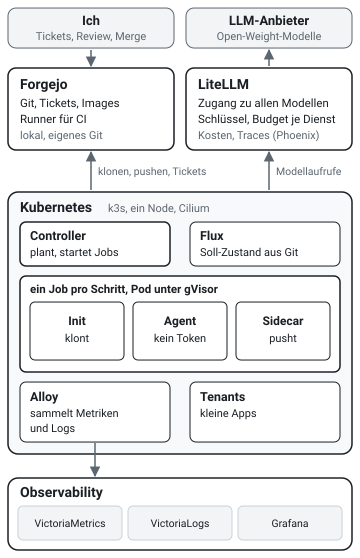
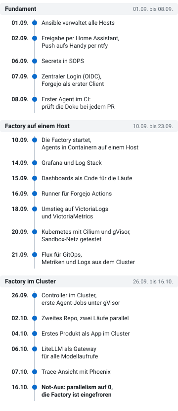

## Das Setup

Der [Feldbericht]() erzählt fünf Wochen mit meiner Factory in Zahlen. Hier kommt die Technik dahinter: wie das Setup aussieht, in welcher Reihenfolge es entsteht und was sich davon übernehmen lässt.



*Das Setup am 16.10., vor dem Not-Aus.*

Im Kern steht ein Kubernetes-Cluster mit einem Node. Für jeden Schritt eines Tickets startet der Controller einen eigenen Job. Im Pod läuft der Agent unter gVisor. Klonen darf nur ein Init-Container, pushen nur ein Sidecar. Git, Tickets und Images liegen in einem eigenen Forgejo.

Jeder Modellaufruf geht über LiteLLM. Jeder Dienst hat dort einen eigenen Schlüssel, eine Liste erlaubter Modelle und ein Budget. Die Kosten landen als Metrik in VictoriaMetrics, jede Anfrage als Trace in Phoenix. Logs und Metriken aus dem Cluster sammelt Alloy, Grafana zeigt alles an.

Seit dem 16.10. ist die Factory eingefroren. Der Controller läuft noch, startet aber keine Jobs mehr. Alles andere läuft weiter: Forgejo mit Runnern, LiteLLM für LibreChat, die Observability und Flux.

## Was in welcher Reihenfolge entsteht



*Was in welcher Reihenfolge entsteht.*

Zuerst kommt das Fundament: Ansible für alle Hosts, Secrets in SOPS, ein zentraler Login und Freigaben per Push aufs Handy. Die Factory startet am 10.09. auf einem einzelnen Host. Vier Tage später kommt die Observability dazu, nach zehn Tagen der Cluster. Am 26.09. laufen die ersten Agent-Jobs im Cluster. Ab dem 06.10. geht jeder Modellaufruf über LiteLLM.

Die Plattform wächst mit der Factory, nicht vor ihr. Jedes Stück kommt, wenn die Factory es braucht.

## Grenzen, die man testen kann

Ein Lauf weiß nichts vom vorigen. Jeder bekommt einen frischen Job, ohne ServiceAccount-Token und damit ohne Zugriff auf die Kubernetes-API.

Der Agent hat kein Token, weder für Git noch für die API. Ein Test prüft das am gebauten Job, ohne Cluster. Diese Grenze hält die ganzen fünf Wochen.

Mergen ist Sache des Menschen, nicht der Agents. Ein Test durchsucht jede getrackte Datei nach den Merge-Aufrufen der Forgejo-API. So fällt jede neue Stelle sofort auf.

Jedes Image muss per Digest gepinnt sein, sonst baut der Job-Builder keinen Job. Der Job-Builder selbst ist eine reine Funktion mit 481 Zeilen und lässt sich offline testen.

Und der Not-Aus ist eine Zahl. Zum Abschalten am 16.10. genügt eine geänderte Zeile in der Konfiguration:

```diff
-  "parallelism": 2,
+  "parallelism": 0,
```

Der Controller liest die Konfiguration bei jedem Durchlauf neu, ein Neustart ist nicht nötig. Dieselbe Bremse zieht er auch selbst: Fällt der LLM-Anbieter aus, stehen die freien Plätze auf null, bis ein Probelauf wieder durchgeht.

Jede dieser Grenzen ist klein, und fast jede lässt sich ohne Cluster testen. Keine braucht ein Modell, um zu wirken.

Die Plattform läuft weiter. In der Factory gilt: Alles, was hält, ist eine Grenze.

## Was die Koordination lehrt

Am besten bewährt sich der Planer im Controller. Er ist eine reine Funktion: Er liest keine Datei, keine Umgebung, keine Uhr und kein Netz. Jede seiner Entscheidungen lässt sich so offline nachstellen.

Die Ausführung daneben verdient dieselbe Form, wächst aber zu einer einzigen Funktion mit 670 Zeilen. Die Lehre: auch die Ausführung in kleine Schritte schneiden, einen pro Aktivität.

Zustand gehört an einen Ort. Labels und Marker in Ticket-Kommentaren funktionieren, und den Fortschritt sieht man direkt im Ticket. Bei zwölf Arten von Markern wird das Lesen aber selbst zur Logik. Eine Tabelle pro Ticket ist einfacher, das Ticket zeigt dann nur noch an.

Ergebnisse gehören dauerhaft übergeben. In der Factory wartet das Ergebnis eines Laufs nach dem Ende des Agents noch 300 Sekunden im Sidecar auf den Controller. Robuster ist es, wenn der Lauf sein Ergebnis selbst an einen festen Ort schreibt, bevor er endet.

Das Protokoll zwischen Agent und Controller ist streng: JSONL, Schemas, ein Marker für Vollständigkeit. Am meisten verdient diese Strenge die eine Zeile, auf die es ankommt: den Status. In der Factory ist das eine Textzeile mit `RESULT:`. Ein festes Feld im Schema ist die einfachere Grenze.

Wirksam sind die ADRs, hinter denen ein Test steht. Von 40 ADRs haben acht keine Durchsetzung im Code, fast nur Regeln für den Prozess. Die Lehre: eine ADR erst schreiben, wenn klar ist, was sie durchsetzt.

## Was sich übernehmen lässt

Grenzen zuerst bauen und offline testen. Koordination nur so viel, wie ein Messwert verlangt.

Ein Gateway vor allen Modellen lohnt sich ab dem ersten Tag. In der Factory kommt LiteLLM erst in der vierten Woche. Ab dann sind die Kosten pro Dienst sichtbar, und kein Client muss davon wissen.

Auch Egress lässt sich eng schließen. Am ersten Tag des Clusters läuft ein Test mit einer FQDN-Allowlist in Cilium: Das erlaubte Ziel ist erreichbar, ein anderes Ziel und das LAN sind blockiert. Diese Grenze gehört von Anfang an eingeschaltet.

Die beste Grenze macht im Alltag keine Arbeit. In einem anderen Repo, für das die Factory arbeitet, setzt der Build-Workflow den Digest-Pin selbst. Es gibt keinen zweiten Commit und keinen eigenen Schritt. Kein Agent muss daran denken, und die Grenze hält trotzdem. Genau diese Art von Grenze überdauert die Factory.

Am Anfang steht eine Factory. Am Ende bleiben die Plattform und ein paar einfache Grenzen.
