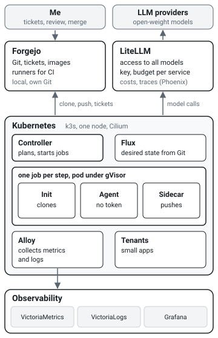
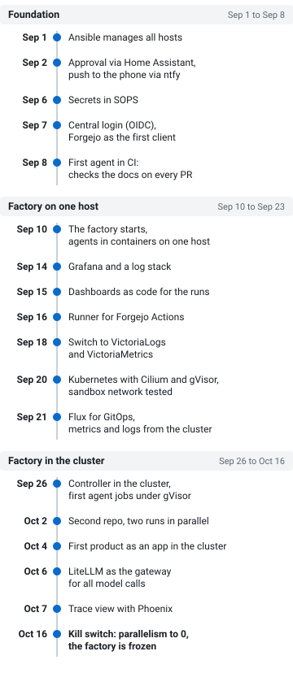

## The Setup

The [field report]() tells five weeks with my factory in numbers. This post covers the technology behind it: what the setup looks like, in what order it comes together, and what is worth taking from it.



*The setup on October 16, before the kill switch.*

At the core is a Kubernetes cluster with a single node. For every step of a ticket, the controller starts its own job. Inside the pod, the agent runs under gVisor. Only an init container may clone, and only a sidecar may push. Git, tickets and images live in a dedicated Forgejo instance.

Every model call goes through LiteLLM. Each service has its own key there, a list of allowed models and a budget. Costs land as metrics in VictoriaMetrics, every request as a trace in Phoenix. Alloy collects logs and metrics from the cluster, and Grafana shows all of it.

Since October 16, the factory has been frozen. The controller still runs but starts no more jobs. Everything else keeps running: Forgejo with its runners, LiteLLM for LibreChat, the observability stack and Flux.

## In What Order It Comes Together



*In what order it comes together.*

First comes the foundation: Ansible for all hosts, secrets in SOPS, a central login and approvals by push notification to the phone. The factory starts on September 10 on a single host. Observability follows four days later, the cluster after ten days. On September 26, the first agent jobs run in the cluster. From October 6, every model call goes through LiteLLM.

The platform grows with the factory, not ahead of it. Each piece arrives when the factory needs it.

## Boundaries You Can Test

A run knows nothing about the previous one. Each gets a fresh job, without a service account token and therefore without access to the Kubernetes API.

The agent has no token, neither for Git nor for the API. A test checks this on the built job, without a cluster. This boundary holds for all five weeks.

Merging is a human's job, not the agents'. A test scans every tracked file for merge calls to the Forgejo API. Any new occurrence shows up right away.

Every image must be pinned by digest, or the job builder builds no job. The job builder itself is a pure function of 481 lines and can be tested offline.

And the kill switch is a number. Shutting down on October 16 takes one changed line in the configuration:

```diff
-  "parallelism": 2,
+  "parallelism": 0,
```

The controller rereads the configuration on every cycle, so no restart is needed. It also pulls the same brake on its own: if the LLM provider goes down, the free slots drop to zero until a single probe run gets through again.

Each of these boundaries is small, and almost all of them can be tested without a cluster. None of them needs a model to work.

The platform keeps running. In the factory, everything that holds is a boundary.

## What Coordination Teaches

The planner in the controller proves itself best. It is a pure function: it reads no file, no environment, no clock and no network. That way, every one of its decisions can be replayed offline.

The execution next to it deserves the same shape, but grows into a single function of 670 lines. The lesson: cut the execution into small steps too, one per activity.

State belongs in one place. Labels and markers in ticket comments work, and progress is visible right in the ticket. With twelve kinds of markers, though, reading them becomes logic of its own. A table per ticket is simpler, and the ticket then only displays.

Results should be handed over durably. In the factory, a run's result waits in the sidecar for another 300 seconds after the agent ends, until the controller picks it up. It is more robust if the run writes its result to a fixed place itself before it ends.

The protocol between agent and controller is strict: JSONL, schemas, a completeness marker. This strictness matters most for the one line that counts: the status. In the factory, that is a text line starting with `RESULT:`. A fixed field in the schema is the simpler boundary.

The ADRs that work are the ones backed by a test. Of 40 ADRs, eight have no enforcement in code, almost all of them process rules. The lesson: write an ADR only once it is clear what enforces it.

## What Is Worth Taking

Build boundaries first and test them offline. Add only as much coordination as a measurement calls for.

A gateway in front of all models pays off from day one. In the factory, LiteLLM only arrives in week four. From then on, cost per service is visible, and no client needs to know about it.

Egress can be locked down tightly, too. On the cluster's first day, a test runs with an FQDN allowlist in Cilium: the allowed destination is reachable, while another destination and the LAN are blocked. This boundary belongs switched on from the start.

The best boundary creates no work in daily use. In another repo the factory works for, the build workflow sets the digest pin itself. There is no second commit and no extra step. No agent has to remember it, and the boundary still holds. This is exactly the kind of boundary that outlasts the factory.

It starts with a factory. What remains is the platform and a few simple boundaries.
